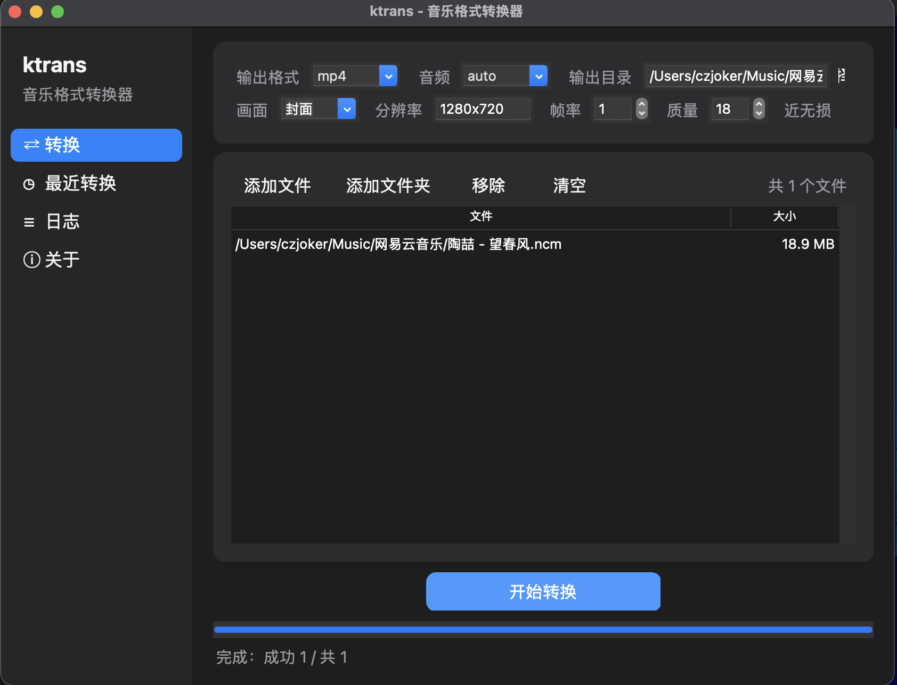
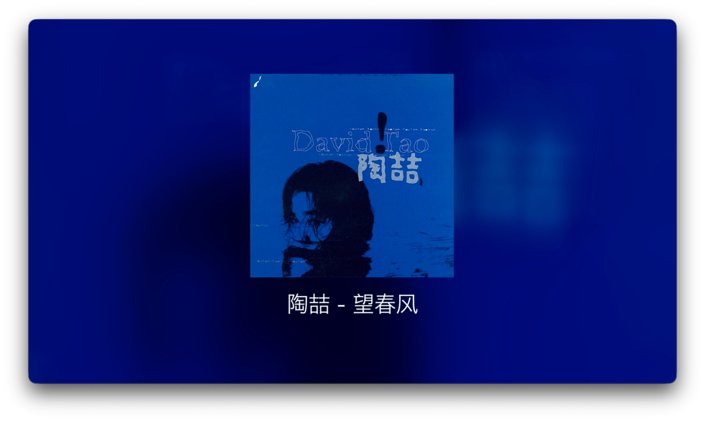

<div align="center">


# 🎵 KTrans

**拖进来，转出去。加密音乐、MP3 / FLAC / WAV → 黑屏视频、封面视频、纯音频，一个软件搞定。**

*Drag. Drop. Converted.*

[](../../releases)
[](LICENSE)
[]()
[]()

[中文](README.md) | [English](README_EN.md)

---

把音乐变成平台要的视频 —— 专为那些"只收视频"的上传平台而生（抖音 / B站 / 视频号…）。
两种画面可选：**真·纯黑屏**（体积最小、压制最友好），或者**专辑封面 + 模糊背景 + 歌名**
（看着像个正经作品）。不想出视频也行，直接导出 mp3 / m4a / flac / wav。

网易云 `.ncm` 与 QQ 音乐 `.qmc / .mflac / .mgg` 全部内置解密，加密文件拖进来就是能用的成品。

</div>

## 📸 效果

界面（深色模式，v2.10）：



封面模式产出的成片（`.ncm` 自带封面 + 标签，直接出片）：



## ✨ 为什么是 KTrans

| | |
|:---:|:---|
| 🖤 **真黑屏** | 不是"看着黑"，是像素值 Y=0 的**纯黑**。利用 `color_range` 全范围标记，解决 ffmpeg 默认黑屏源 Y=16（肉眼黑但不是黑）的问题。 |
| 🖼️ **封面模式** | 自动抠出内嵌专辑图：模糊放大铺底 + 居中封面 + 歌名/歌手文字，长标题自动缩字号加省略号。无封面的文件自动退回"黑底 + 居中歌名"。 |
| 🎁 **NCM 全支持** | 内置网易云 `.ncm` 解密器（纯 Python 实现，无需第三方库），连元数据与内嵌封面一起解出来直接用。 |
| 🎵 **QQ 音乐全系** | `.qmc0/2/3/4/6/8`、`.qmcflac`、`.qmcogg`、`.mflac*`、`.mgg*`、`.tkm`、`.bkc*` 全部支持，静态表 / 映射表 / RC4 变体三种加密逐一还原。 |
| 🎧 **音频智能封装** | 自动探测源编码：MP3 / AAC 原样封装保证无损，FLAC 等其他编码自动转 AAC —— 解决抖音"提取音乐失败"。 |
| 🔄 **不只出 MP4** | 也能只出音频：MP3 / M4A / FLAC / WAV，同源编码直接 copy 无损、内嵌封面一起带走。 |
| 🪶 **轻量** | 核心转换零第三方依赖，只依赖系统 ffmpeg。 |

## 📦 安装

### 1. 安装 ffmpeg

```bash
brew install ffmpeg
```

### 2. （可选）GUI 拖拽支持

```bash
pip install tkinterdnd2
```

### 3. 启动

```bash
# GUI
python3 mp3_to_mp4_gui.py
# 或直接双击 启动GUI.command

# 命令行
python3 mp3_to_mp4.py 音乐.mp3
python3 mp3_to_mp4.py *.ncm *.flac --audio-codec auto
```

### 4. 打包成 macOS App

有两个脚本，按需要选：

```bash
./build_dist.sh    # 推荐：py2app 全量打包，独立可分发（约 31 MB）
./build_app.sh     # 轻量：外壳 + 启动脚本，只在本机能跑（秒级）
```

**`build_dist.sh`（独立版）**：把解释器、`tkinterdnd2`、Tcl/Tk 运行时全部塞进 bundle，
对方机器不用装 Python，双击即用（仍需装 ffmpeg）。产物 `dist/ktrans.app`。

```bash
ditto -c -k --keepParent dist/ktrans.app ktrans.zip   # 压缩后发给别人
```

首次构建需要准备环境（已 `.gitignore`，不会进仓库）：

```bash
python3 -m venv .venv-pack
.venv-pack/bin/pip install py2app tkinterdnd2
```

> 构建脚本自动处理三件 py2app 自己搞不定的事：把 Tcl/Tk 的 dylib 放进 `Resources/lib`
> 命中 `_tkinter.so` 自带的 rpath；拷贝 `tcl9.0` / `tk9.0` 脚本库；改完文件后重新 ad-hoc 签名。

**`build_app.sh`（轻量版）**：只生成外壳 + 启动脚本，启动器里记录本机 Python 路径，
换台机器要重跑一次。

- 排障：双击没反应 / 闪退时看日志 `/tmp/ktrans.log`
- 拖文件到 Dock 图标 / 访达「打开方式」：**App 已在运行时可用**；冷启动直接带文件不生效
  （macOS 的 odoc 事件在 Tk 9 里没有内置支持，事件在 Python 起来前就被丢了）

## 🖱️ 使用

### GUI

把文件（或整个文件夹）拖进窗口就行——没添加文件时，列表区域本身就是拖放区。
左侧边栏可查看转换记录、日志、关于。

输出选 `mp4` 时多出一行「画面」：**纯黑**（体积最小，平台压制最友好）或 **封面**（专辑图 + 模糊背景 + 歌名歌手）。

### 命令行

```bash
python3 mp3_to_mp4.py <文件...> [-o 输出目录] [--audio-codec auto|copy|aac] [--overwrite]

  --audio-codec auto   默认。MP3/AAC 原样封装，其他自动转 AAC 192k（推荐）
  --audio-codec copy   无条件原样封装（FLAC 转出的 MP4 部分平台无法提取音频）
  --audio-codec aac    无条件转 AAC 192k
  --video black|cover  画面：black 纯黑屏（默认，体积最小）/ cover 封面模式
  --format mp4|mp3|m4a|flac|wav   输出格式（默认 mp4）
  --overwrite          覆盖已存在的输出文件（默认自动加 " 2" 后缀去重）
```

封面模式示例：

```bash
python3 mp3_to_mp4.py 夜曲.mp3 --video cover -r 1920x1080
# [封面] 夜曲 Nocturne — 周杰伦 Jay Chou
# [完成] 夜曲.mp4  (213.3 KB)
```

## 🎼 支持格式

| 输入 | 说明 |
|---|---|
| `.ncm` | 网易云私有格式，内置解密（解出什么就是什么，通常是 FLAC/MP3） |
| `.qmc*` `.mflac*` `.mgg*` `.tkm` `.bkc*` | QQ 音乐 / Moo 音乐私有格式，内置解密（算法移植自 unlock-music，已逐字节对齐验证）⚠️ MusicEx 尾标的文件暂不支持（密钥在客户端数据库） |
| `.mp3` / `.aac` / `.m4a` / `.mp4`（纯音频） | 原样封装，零转码 |
| `.flac` / `.wav` / `.ogg` / `.opus` / `.ape` / `.wma` / `.aiff` 等 | 只要 ffmpeg 认识就行，auto 模式下自动转 AAC |

输出默认 **`.mp4`**（H.264 视频 + 音频轨），同名输出，撞名自动加后缀；
也可以只出音频（`--format mp3/m4a/flac/wav`）。

## ⚙️ 工作原理

1. **NCM 解密**（`ncm_decoder.py`）：魔数校验 → AES-128-ECB 解出 RC4 密钥 → NCM 变体 RC4 流 XOR 还原音频字节；元数据块与内嵌封面一并解析。
2. **QMC 解密**（`qmc_decoder.py`）：尾部密钥 → TencentTEA 派生 → 按密钥长度选静态表 / 映射表 / RC4 变体还原。
3. **探测**：ffprobe 一次拿到时长、音频编码、`attached_pic` 封面流和 ID3 标签（歌名/歌手）。
4. **合成**：`color=c=black` 生成黑帧源，`-color_range 2` 标记全范围让解码端得到 Y=0 真黑；黑帧视频轨用显式时长与音频精确对齐。

> 💡 之前用 `-shortest` 对齐时，1fps 黑屏视频编码太快，会在音频结束前"冲过头"产生多余帧——所以改为给 color 滤镜显式 `d=<时长>`。

5. **封面模式**：内嵌封面导出成图片 → `split` 成两路：一路放大裁切 + 高斯模糊 + 压暗当背景，一路按比例缩到画面高度的 56% 居中叠上去 → `drawtext` 写歌名/歌手（文字走 `textfile=`，彻底绕开滤镜转义问题）。画面用 `-loop 1` 循环静态图，再用 `-t` 卡到音频时长。

## ⚠️ 声明

- 私有格式解密功能（`.ncm` / `.qmc*` / `.mflac*` / `.mgg*` 等）仅用于**转换本人合法获取的音频文件**的本地格式，请勿用于绕过版权保护传播作品。支持下正版 🎵
- QMC 解密算法移植自 [unlock-music](https://git.unlock-music.dev/um/cli)（MIT License），感谢原作者。
- 界面布局参考 [Filee](https://github.com/KnifeLemon/Filee)（MIT License）。
- 本项目与网易云音乐、腾讯音乐官方无关。

## 🙏 致谢

- [unlock-music](https://git.unlock-music.dev/um/cli)（MIT License）—— QMC 解密算法的来源，移植时用上游的测试向量做了逐字节比对验证。
- [ncmdump](https://github.com/taurusxin/ncmdump)（MIT License）—— NCM 格式的公开资料参考。
- [Filee](https://github.com/KnifeLemon/Filee)（MIT License）—— 界面布局与视觉风格参考。

## 🗺️ Roadmap

- [x] py2app 独立打包（`build_dist.sh`，免 Python 环境，可直接分发给别人）
- [x] 拖文件到 Dock 图标（App 运行中可用，见上方限制说明）
- [ ] 自定义 App 图标
- [ ] Windows 版

## 📄 License

[MIT](LICENSE) © [Kliocp-gpu](https://github.com/Kliocp-gpu)
